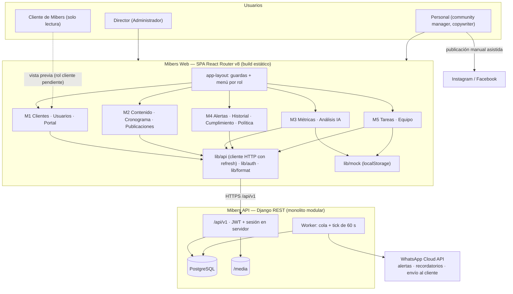

# Informes por módulo — Mibers Web

| Módulo                                   | Informe                    | API                                                      |
| ---------------------------------------- | -------------------------- | -------------------------------------------------------- |
| 1. Administración de Clientes y Usuarios | [modulo-1.md](modulo-1.md) | Real (portal del cliente: vista previa con datos reales) |
| 2. Gestión y Publicación de Contenido    | [modulo-2.md](modulo-2.md) | Real                                                     |
| 3. Métricas y Analítica (con IA)         | [modulo-3.md](modulo-3.md) | Real; análisis con IA simulado                           |
| 4. Notificaciones y Trazabilidad         | [modulo-4.md](modulo-4.md) | Real                                                     |
| 5. Supervisión del Equipo                | [modulo-5.md](modulo-5.md) | Simulada en el navegador                                 |

Cada informe incluye qué se hizo, su diagrama de arquitectura, cómo administré los subagentes y lo pendiente.

## Arquitectura del sistema completo

## Equipo de agentes (resumen)

- **Yo (Claude, líder y product owner):** configuración del proyecto y del repositorio, hook que impide coautorías de
  agentes, convenciones (`AGENTS.md`), contratos de API, mapa de rutas, componentes compartidos mínimos para
  desacoplar a los agentes, revisión, correcciones puntuales y **todos los commits** (autor: Jorge Andrés Reyes Serrano).
- **gpt-6.1-sol (Codex):** lógica de negocio, sesión, formularios complejos y cada QA (siempre una instancia nueva, que no
  escribió el código que prueba). 13 tareas: 8 de implementación y 5 de QA.
- **deepseek-v4.1-flash (OpenCode):** tareas acotadas y presentacionales con especificación detallada. 6 tareas
  entregadas, todas correctas a la primera; a la séptima llegó al límite de uso gratuito y el resto pasó a Sol con
  esfuerzo bajo.
