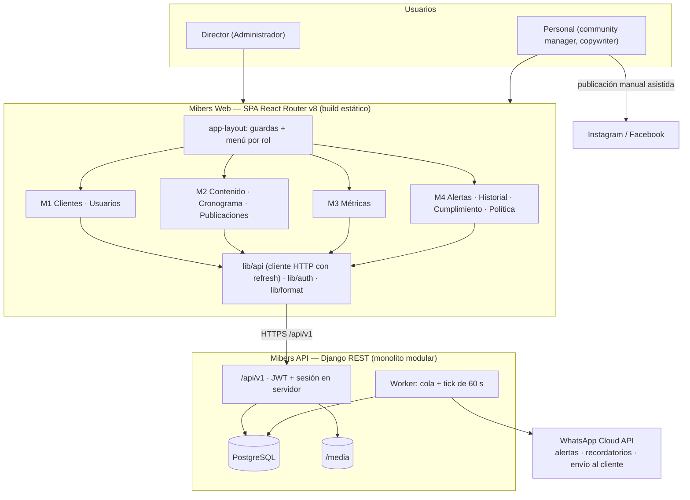

# Informes por módulo — Mibers Web

| Módulo                                   | Informe                    | API                                              |
| ---------------------------------------- | -------------------------- | ------------------------------------------------ |
| 1. Administración de Clientes y Usuarios | [modulo-1.md](modulo-1.md) | Real (portal del cliente retirado el 22/11/2026) |
| 2. Gestión y Publicación de Contenido    | [modulo-2.md](modulo-2.md) | Real                                             |
| 3. Métricas y Analítica                  | [modulo-3.md](modulo-3.md) | Real (análisis con IA retirado el 22/11/2026)    |
| 4. Notificaciones y Trazabilidad         | [modulo-4.md](modulo-4.md) | Real                                             |
| 5. Supervisión del Equipo                | [modulo-5.md](modulo-5.md) | Vacío: funciones retiradas el 22/11/2026         |

Cada informe incluye qué se hizo, su diagrama de arquitectura, cómo administré los subagentes y lo pendiente.

**Funciones retiradas (22/11/2026).** El Acta 3 dejó fuera del alcance cuatro funciones y la decisión se ratificó el
22/11/2026, así que se eliminaron del frontend junto con los datos simulados en el navegador (`lib/mock`):

| Función                  | Pantalla             | HU / RF      |
| ------------------------ | -------------------- | ------------ |
| Tareas del equipo        | `/tareas`            | HU-22 / RF21 |
| Panel de supervisión     | `/equipo`            | HU-23 / RF22 |
| Análisis asistido por IA | `/metricas/analisis` | HU-26 / RF24 |
| Portal del cliente       | `/portal/:clienteId` | HU-27 / RF25 |

Con esto el módulo 5 queda vacío.

## Arquitectura del sistema completo

## Equipo de agentes (resumen)

- **Yo (Claude, líder y product owner):** configuración del proyecto y del repositorio, hook que impide coautorías de
  agentes, convenciones (`AGENTS.md`), contratos de API, mapa de rutas, componentes compartidos mínimos para
  desacoplar a los agentes, revisión, correcciones puntuales y **todos los commits** (autor: Jorge Andrés Reyes Serrano).
- **gpt-6.1-sol (Codex):** lógica de negocio, sesión, formularios complejos y cada QA (siempre una instancia nueva, que no
  escribió el código que prueba). 13 tareas: 8 de implementación y 5 de QA.
- **deepseek-v4.1-flash (OpenCode):** tareas acotadas y presentacionales con especificación detallada. 6 tareas
  entregadas, todas correctas a la primera; a la séptima llegó al límite de uso gratuito y el resto pasó a Sol con
  esfuerzo bajo.

## Auditoría final de requerimientos (FP7)

Una instancia nueva de gpt-6.1-sol, con contexto limpio, revisó los 43 requerimientos y las 20 historias de usuario de
`requerimientos-historias-fp7.md` contra el código, la API real y el navegador. Resultado: **todo cumple salvo RNF01**
(cierre de sesión tras 30 minutos de inactividad): el refresco automático de Tareas y Equipo mantenía viva la sesión y
no había temporizador en el cliente.

Corrección (yo): `lib/auth/idle.ts` mide la actividad humana (teclado, puntero, desplazamiento); a los 30 minutos sin
actividad cierra la sesión en el servidor, limpia los tokens y lleva a `/login?motivo=inactividad`. Está activo en el
panel, y el refresco automático de Tareas solo corría si hubo actividad en los últimos 5 minutos, así que ya no
prolongaba una sesión inactiva. (Tareas, Equipo y el portal se retiraron el 22/11/2026; ver arriba.)
