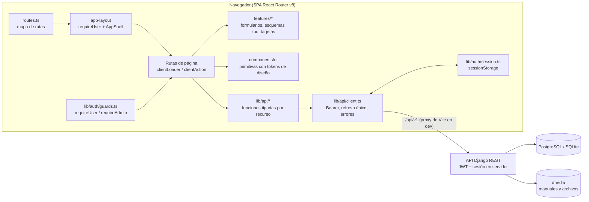

# Módulo 1 — Administración de Clientes y Usuarios

Estado: **terminado y verificado por QA** (navegador real contra la API Django). El **portal del cliente**
(`/portal/:clienteId`, HU-27 / RF25), que se había entregado con el módulo 5 como vista previa, **se retiró el
22/11/2026 por estar fuera del alcance del Acta 3**, junto con el botón "Ver portal del cliente" de la ficha.

## Qué se hizo

### Base del proyecto (sirve a todos los módulos)

- **React Router v8 en modo framework, SPA** (`ssr: false`): la API es un servicio aparte con JWT, así que no hace
  falta un servidor Node; `build/client` es estático y se despliega en cualquier hosting.
- **TypeScript estricto, Tailwind v4, zod, Vitest + Testing Library, ESLint, Prettier, pnpm.**
- **Tokens de diseño** en `app/app.css` (`bg-surface`, `text-ink-muted`, `bg-brand-600`…): cuando el cliente entregue
  el manual de marca (riesgo R1.3 del charter) se cambia la identidad en un solo archivo.
- **Proxy de Vite** `/api → localhost:8000`: en desarrollo no hay problemas de CORS.
- **Mapa de rutas central** (`app/routes.ts`) con las rutas de los cinco módulos.
- **Repositorio git local** con hook `commit-msg` (`.githooks/`) que elimina trailers `Co-authored-by` y rechaza
  autores que sean agentes de IA. Todos los commits son de Jorge Andrés Reyes Serrano.

### Sesión y seguridad (HU-01, HU-03, RF1, RF2, RNF01)

| Funcionalidad        | Detalle                                                                                                                                                                                                   |
| -------------------- | --------------------------------------------------------------------------------------------------------------------------------------------------------------------------------------------------------- |
| Inicio de sesión     | Usuario y contraseña, sin registro público. Mensajes para credenciales incorrectas, cuenta bloqueada 15 min (5 intentos) y servidor caído.                                                                |
| Sesión               | Tokens en `sessionStorage` (cerrar la pestaña cierra la sesión: nadie que tome el equipo ve datos). Renovación automática del access token con un único refresh compartido entre peticiones concurrentes. |
| Inactividad (30 min) | La controla el servidor; el frontend redirige a `/login?motivo=inactividad` con el mensaje correspondiente y vuelve a la página donde estaba (`next` saneado contra redirecciones abiertas).              |
| Contraseña temporal  | Un usuario con `must_change_password` solo puede ir a `/cambiar-contrasena`.                                                                                                                              |
| Cambio voluntario    | Desde "Mi perfil", validando la contraseña actual.                                                                                                                                                        |
| Cierre de sesión     | Revoca la sesión en el servidor y limpia el navegador.                                                                                                                                                    |

### Gestión del personal (HU-02, RF2, RF3) — solo Administrador

Lista con filtro Activos/Inactivos/Todos (tabla en escritorio, tarjetas en móvil), crear (la contraseña temporal se
muestra **una sola vez** con botón de copiar), editar (rol, cargo informativo, WhatsApp para alertas), desactivar/activar
con confirmación (no borra lo que hizo la persona) y restablecer contraseña. El Personal no ve el menú y la ruta
responde 403 dentro del shell.

### Clientes (HU-05, HU-06, HU-07, HU-08, RF5, RF6, RF7)

| Pantalla                   | Detalle                                                                                                                                                                                                |
| -------------------------- | ------------------------------------------------------------------------------------------------------------------------------------------------------------------------------------------------------ |
| Inicio — Empresas actuales | Clientes activos con avance semanal (programadas vs. plan), pendientes por estado y próximas publicaciones.                                                                                            |
| Lista de clientes          | Búsqueda, filtro por estado y estrategia, paginación de 25, contactos autorizados y estado de redes.                                                                                                   |
| Crear / editar             | Datos de la empresa, contacto principal, contrato y plan (posts/semana, fechas), estrategia (Viralizar/Posicionar/Vender), objetivo y **manual de marca** (PDF, imágenes, Office o ZIP ≤ 25 MB).       |
| Ficha                      | Contrato con días restantes o "Vencido" (día de Colombia), estrategia y descarga autenticada del manual.                                                                                               |
| Contactos WhatsApp         | Alta/edición/baja con validación E.164 y **autorización Ley 1581** (sin autorización no se le envía contenido).                                                                                        |
| Redes sociales             | Instagram y Facebook: registro manual por el Administrador (la agencia no es Tech Provider de Meta; nunca se guardan contraseñas) y estado Vinculada/Expirada/Desvinculada. El Personal solo consulta. |
| Desactivar / reactivar     | Con aviso de que el historial se conserva un año.                                                                                                                                                      |

### Pruebas y verificación

- Pruebas automáticas: cliente HTTP (refresh concurrente, expiración, contraseña obligatoria, multipart), errores,
  guardas, formatos de fecha en hora de Colombia, esquemas de formularios, shell de navegación y componentes.
- **QA (agente Sol independiente) en navegador real**: 16 flujos OK (login, bloqueo, `next`, logout, cambio obligatorio,
  inicio, usuarios, restricciones del Personal, clientes, manual, desactivación, contactos, redes, perfil, 360 px,
  consola). Un único defecto menor (doble punto en una fecha), ya corregido. Ningún defecto grave ni notorio.

## Arquitectura

Flujo de una pantalla: la ruta declara un `clientLoader` que primero pasa por la guarda (`requireUser`/`requireAdmin`) y
luego llama funciones de `lib/api`. Los formularios envían a un `clientAction` que valida con zod, llama a la API y
devuelve errores por campo (`ApiError.fieldErrors`) o redirige. Tras cada mutación React Router revalida los loaders.
El cliente HTTP centraliza los casos de sesión: 401 → refresh → reintento; `session_expired` → login con motivo;
`password_change_required` → cambio de contraseña.

## Cómo administré los subagentes

**Mi rol:** product owner y líder técnico. Configuré el proyecto, git y el hook anti-coautoría; escribí `AGENTS.md`
(reglas: no commits, solo los archivos asignados, tokens de diseño, textos con tildes, `pnpm typecheck && lint && test`
en verde) y el contrato de la API (`docs/api-modulo-1.md`) leyendo el backend; definí el mapa de rutas; revisé cada
entrega y **hice yo todos los commits**, uno por funcionalidad, para controlar autoría y calidad.

**Reparto por dificultad:**

| Agente   | Modelo                         | Tareas en el módulo 1                                                                                            | Por qué                                                                                     |
| -------- | ------------------------------ | ---------------------------------------------------------------------------------------------------------------- | ------------------------------------------------------------------------------------------- |
| Sol      | gpt-6.1-sol (Codex)            | Capa API + sesión + guardas; login, cambio de contraseña, layout, perfil y usuarios; módulo de clientes completo | Lógica con estado, seguridad y reglas de negocio                                            |
| DeepSeek | deepseek-v4.1-flash (OpenCode) | 17 primitivas de UI; shell de navegación responsivo + 404; inicio "Empresas actuales"                            | Tareas acotadas y presentacionales, con especificación detallada de props, clases y pruebas |
| Sol (QA) | gpt-6.1-sol, instancia nueva   | Pruebas de punta a punta en navegador                                                                            | Ojos frescos, sin el sesgo de quien escribió el código                                      |

**Estrategia de paralelismo:**

1. _Fase 1 (paralela):_ Sol con la capa de datos y DeepSeek con las primitivas visuales; no comparten archivos.
2. _Fase 2 (paralela, 3 agentes):_ Sol A (auth/usuarios), Sol B (clientes) y DeepSeek (inicio). Para que no se
   bloquearan creé yo el hook `useCurrentUser` y los placeholders de todas las rutas antes de lanzarlos.
3. _Fase 3:_ QA con un Sol nuevo; mientras tanto ya arrancaba el módulo 2 sobre archivos distintos.

**Incidencias:** Sol reportó "completo" la primera vez sin `clientes.ts`/`index.ts`; lo detecté en la revisión y lo
incluí en la tarea siguiente. Con las especificaciones detalladas, DeepSeek entregó en todos los casos código correcto
que respetaba los tokens. Más tarde, en el módulo 2, DeepSeek llegó al límite de uso gratuito de OpenCode y sus tareas
simples pasaron a Sol con esfuerzo bajo.

## Pendiente

- Identidad visual definitiva cuando llegue el manual de marca de Mibers (solo hay que cambiar `app/app.css`).
