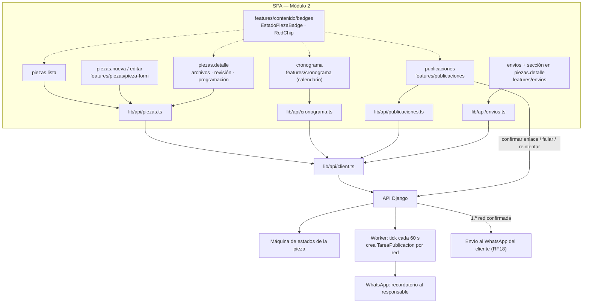

# Módulo 2 — Gestión y Publicación de Contenido

Estado: **terminado y verificado por QA** en navegador real contra la API Django (flujo completo de una pieza, de la
creación a la publicación en Instagram y Facebook). Contratos: `docs/api-modulo-2-piezas.md` y
`docs/api-modulo-2-publicacion.md`.

## Qué se hizo

| Pantalla                             | Requisitos             | Detalle                                                                                                                                                                                                                                                                                                                                                                                                                                                                                       |
| ------------------------------------ | ---------------------- | --------------------------------------------------------------------------------------------------------------------------------------------------------------------------------------------------------------------------------------------------------------------------------------------------------------------------------------------------------------------------------------------------------------------------------------------------------------------------------------------- |
| **Contenido** (`/piezas`)            | RF8, RF10              | Lista con filtros por cliente, estado, tipo, red, fechas y búsqueda; chips rápidos por estado y **Historias** ("gestión de historias" del charter).                                                                                                                                                                                                                                                                                                                                           |
| **Nueva / editar pieza**             | RF8, RF9, RF11, RF12   | Cliente, título, tipo (post, carrusel, reel, historia, portada), redes, fecha y hora en **hora de Colombia**, copy común o **copy distinto por red**, hashtags, enlaces, campaña, responsable y mensaje para el cliente. Editar una pieza aprobada o programada avisa que vuelve a revisión. Una pieza publicada no se puede abrir en edición.                                                                                                                                                |
| **Detalle de la pieza**              | RF8, RF12, RF14, RNF09 | Archivos con vista previa (descarga autenticada), carga múltiple con los errores de formato, proporción y duración que devuelve el backend por red, reordenar, eliminar y archivo editable. Revisión: el personal envía; **solo el Administrador** aprueba o solicita cambios con comentario; historial de revisiones. **Programación con vista previa obligatoria** (cliente, cuentas destino con su estado, copy por red y hora) antes de confirmar; cancelar programación.                 |
| **Cronograma** (`/cronograma`)       | RF20, HU-21            | Por cliente, vista semanal y mensual (lunes primero), anterior/hoy/siguiente, filtros por red y estado, leyenda de estados. En móvil pasa a una lista por día.                                                                                                                                                                                                                                                                                                                                |
| **Publicaciones** (`/publicaciones`) | RF15–RF17, HU-15/16/18 | **Publicación manual asistida** (la agencia no es Tech Provider de Meta): a la hora programada el servidor crea una tarea por red; el personal copia el copy, descarga los archivos, publica y **confirma con el enlace**, o **reporta el fallo** con su motivo y puede **reintentar**. Las vencidas se resaltan.                                                                                                                                                                             |
| **Inicio**                           | RF5                    | Ahora también cuenta las _publicaciones por confirmar_ de cada cliente (defecto encontrado por QA).                                                                                                                                                                                                                                                                                                                                                                                           |
| **Envíos al cliente** (`/envios`)    | HU-19, RF18            | Registro de las piezas enviadas por WhatsApp a los contactos autorizados: fecha, cliente, pieza (enlace), contacto, **número enmascarado** tal como lo entrega la API, archivo, estado (Pendiente, Enviado, Entregado, Leído, Fallido con su motivo), enviado y entregado. Filtros por cliente, estado y fechas en la URL y paginación. El detalle de la pieza tiene la sección "Envíos al cliente" cuando está publicada o compartida, o si ya tiene envíos. Contrato: `docs/api-envios.md`. |

## Verificación

- Pruebas automáticas: API de piezas y publicaciones, esquemas (copy por red, redes obligatorias), conversión
  `datetime-local` ↔ ISO en hora de Colombia, utilidades de calendario (semana desde el lunes, relleno del mes,
  agrupación por día) y validación de URL.
- **QA (Sol, instancia nueva) en navegador**, con sesiones separadas de personal y director: contenido, archivos válidos e
  inválidos, revisión completa con cambios solicitados, edición de pieza aprobada, programación con vista previa y
  bloqueo sin cuentas, cronograma, tick del scheduler, confirmación, fallo y reintento, 360 px y consola.
- Defectos: **notorio** — el Inicio no mostraba las tareas de publicación pendientes (el resumen del backend solo
  cuenta estados de piezas); lo corregí en el frontend. **Menor** — la URL de edición de una pieza publicada mostraba el
  formulario; QA lo corrigió con una redirección.

## Arquitectura

Ciclo de la pieza que refleja la interfaz:
`Borrador → En revisión → (Cambios solicitados) → Aprobada → Programada → Publicada | Fallida → Compartida`.

## Cómo administré los subagentes

| Agente     | Modelo              | Tarea                                                                                                                                                                                                |
| ---------- | ------------------- | ---------------------------------------------------------------------------------------------------------------------------------------------------------------------------------------------------- |
| Yo (líder) | —                   | Mapa de rutas de los cinco módulos, iconos y menú; insignias compartidas de estado y red (para que los dos agentes no dependieran entre sí); revisión, integración, corrección del Inicio y commits. |
| Sol C      | gpt-6.1-sol         | Piezas: contrato leído del backend, API, lista, formulario, detalle con archivos, revisión y programación. Verificó el flujo completo con curl.                                                      |
| Sol D      | gpt-6.1-sol         | Cronograma y publicaciones, con verificación real: creó datos, ejecutó el tick y confirmó una publicación.                                                                                           |
| Sol QA     | gpt-6.1-sol (nueva) | Pruebas de punta a punta en navegador.                                                                                                                                                               |

Los dos agentes de implementación trabajaron **en paralelo sobre archivos disjuntos** y cada uno escribió el contrato
de su parte (`docs/api-modulo-2-*.md`) leyendo el backend antes de programar. Mientras tanto, DeepSeek avanzó con
pantallas simples del módulo 4 (política de datos, alertas, historial) hasta llegar al **límite de uso gratuito de
OpenCode**; desde entonces sus tareas simples pasaron a Sol con esfuerzo bajo.

Durante la fase paralela los agentes se avisaron de errores de typecheck en archivos ajenos en progreso. No intervine:
cada agente debía dejar sus archivos en verde y así ocurrió.

## Pendiente

- Integración automática con la Graph API de Meta cuando la agencia sea Tech Provider (el backend ya tiene el puerto
  `publishers.py`; el frontend no cambia).
- TikTok queda fuera del alcance (RF16).
