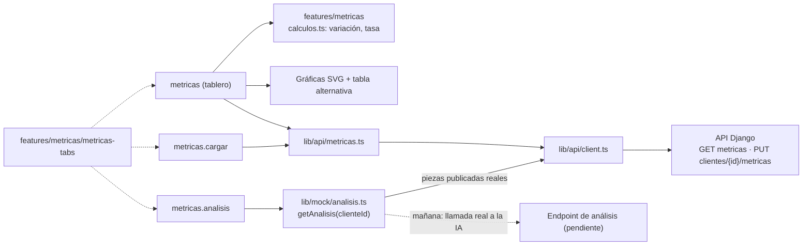

# Módulo 3 — Métricas y Analítica (con apoyo de IA)

Estado: **terminado y verificado por QA** (sin defectos). Tablero e informe mensual con la API real; el análisis con IA
funciona con **datos de demostración** porque el backend aún no lo implementa. Contrato: `docs/api-modulo-3.md`.

## Qué se hizo

| Pantalla                                            | Requisitos                               | Detalle                                                                                                                                                                                                                                                                                                                                                                                                               |
| --------------------------------------------------- | ---------------------------------------- | --------------------------------------------------------------------------------------------------------------------------------------------------------------------------------------------------------------------------------------------------------------------------------------------------------------------------------------------------------------------------------------------------------------------- |
| **Tablero de indicadores** (`/metricas`)            | RF23, HU-24, informe mensual del charter | Por cliente, red (todas/Instagram/Facebook) y periodo (6 o 12 meses): KPIs del último mes (alcance, visualizaciones, interacciones, seguidores y tasa de interacción) con variación frente al mes anterior; gráficas de barras de alcance por red y de seguidores hechas con SVG (sin librerías), cada una con su tabla de datos accesible; tabla mensual por red. Sin exportación de archivos, como pide el charter. |
| **Cargar métricas** (`/metricas/cargar`)            | RF23                                     | Cliente y mes (no se permiten meses futuros); al elegirlos se precargan los valores existentes; los cuatro indicadores de Instagram y Facebook; errores por campo. La agencia no es Tech Provider, así que las métricas se cargan a mano.                                                                                                                                                                             |
| **Análisis asistido por IA** (`/metricas/analisis`) | Charter, módulo 3                        | Por publicación: sentimiento (positivo/neutral/negativo), temas principales, comentarios representativos y un resumen. No genera copies. Usa las piezas publicadas reales del cliente y un **mock determinista** (`lib/mock/analisis.ts`) con la misma firma que tendrá la API (`getAnalisis(clienteId)`); un aviso visible indica que son datos de demostración.                                                     |

Tanto el Administrador como el Personal consultan y cargan métricas.

## Verificación

- Pruebas automáticas: variaciones y tasa de interacción (base cero, alcance cero, valores nulos, sin mes anterior) y
  determinismo del mock.
- **QA (Sol, instancia nueva) en navegador**: con 12 registros reales comprobó KPIs y variaciones a mano (alcance
  25.666, +10,2 %; tasa 7,1 %), filtros, cliente sin datos, precarga, guardado en ambas redes, validaciones (negativos y
  mes futuro), permisos del Personal, análisis estable al recargar, 360 px y consola. **Sin defectos.**

## Arquitectura

## Cómo administré los subagentes

| Agente     | Modelo              | Tarea                                                                                                                                                                     |
| ---------- | ------------------- | ------------------------------------------------------------------------------------------------------------------------------------------------------------------------- |
| Yo (líder) | —                   | Leí el contrato de métricas del backend, decidí gráficas a mano (sin dependencias nuevas) y el diseño del mock con la misma firma de la API futura; integración y commit. |
| Sol E      | gpt-6.1-sol         | Módulo completo: contrato, API, tablero, carga, análisis con mock y pruebas. Cargó 6 meses de datos reales para verificar.                                                |
| Sol QA     | gpt-6.1-sol (nueva) | Pruebas de punta a punta, con verificación numérica de los KPIs.                                                                                                          |

El módulo se desarrolló **en paralelo** con el QA del módulo 2 y con el módulo 5, sobre archivos distintos.

## Pendiente

- Endpoint de análisis con IA en el backend (comentarios de cada publicación + resumen); cambiar la implementación de
  `getAnalisis` sin tocar la interfaz.
- Tablero de horarios de mayor actividad (charter): requiere datos por hora que hoy no entrega la API; RF23 lo deja
  fuera del alcance.
- Sincronización automática con Meta cuando haya credenciales.
