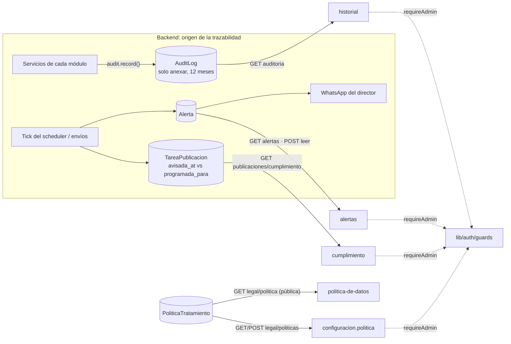

# Módulo 4 — Notificaciones y Trazabilidad

Estado: **terminado y verificado por QA** contra la API real. Los dos defectos notorios que encontró QA ya están
corregidos.

## Qué se hizo

| Pantalla                                                                                         | Requisitos              | Detalle                                                                                                                                                                                                                                                                                                                                                                          |
| ------------------------------------------------------------------------------------------------ | ----------------------- | -------------------------------------------------------------------------------------------------------------------------------------------------------------------------------------------------------------------------------------------------------------------------------------------------------------------------------------------------------------------------------- |
| **Alertas** (`/alertas`, Administrador)                                                          | RF19, RNF12             | Publicaciones fallidas, bloqueadas por falta de aprobación o pendientes sin confirmar, cuentas expiradas o desvinculadas y envíos al cliente fallidos (también llegan al WhatsApp del director). Pestañas No leídas / Leídas / Todas, marcar una o **todas** (recorre todas las páginas), enlaces a la pieza, a las publicaciones o a los clientes según la entidad, paginación. |
| **Cumplimiento** (`/cumplimiento`, Administrador)                                                | RNF06                   | Porcentaje de publicaciones avisadas dentro de ±5 min de la hora programada, últimos 7 y 30 días y rango a elección, contra la meta del 95 %.                                                                                                                                                                                                                                    |
| **Historial** (`/historial`, Administrador)                                                      | RF4, RNF11              | Quién hizo cada acción y cuándo: filtros por persona, acción y fechas (día de Colombia), detalle de los datos de cada registro e IP. Solo lectura; se conserva 12 meses. Tabla en escritorio y tarjetas en móvil.                                                                                                                                                                |
| **Política de datos** (`/configuracion/politica`, Administrador, y `/politica-de-datos` pública) | RNF13, Ley 1581 de 2012 | El administrador publica versiones; la vigente se muestra públicamente sin iniciar sesión.                                                                                                                                                                                                                                                                                       |
| **Estado de cada publicación**                                                                   | Charter                 | Lo cubren las pantallas de Publicaciones y la ficha de la pieza del módulo 2 (publicada con enlace / fallida con motivo).                                                                                                                                                                                                                                                        |

El Personal no ve estas secciones en el menú y, si entra por URL, recibe un 403 dentro del shell.

## Verificación

- Pruebas automáticas de las funciones de API (construcción de filtros, 404 de la política, POST de lectura).
- **QA (Sol, instancia nueva, esfuerzo bajo)**: alertas reales, marcar como leídas, historial con 135 registros y
  filtros, cumplimiento (100 %, meta 95 %), publicación y lectura pública de la política, restricciones del Personal.
- Defectos **notorios** corregidos por mí: (1) las alertas de cuentas y de tareas de publicación no tenían enlace
  porque su entidad es `clients.cuentasocial` / `publishing.tareapublicacion`; (2) "Marcar todas" solo marcaba la
  página visible. **Menor**: las etiquetas del backend venían sin tildes; las alertas ahora usan etiquetas propias.
  QA hizo una revisión parcial del responsive en esta pantalla; los componentes son los mismos que pasaron 360 px en
  los demás módulos.

## Arquitectura

## Cómo administré los subagentes

| Agente     | Modelo                         | Tarea                                                                                                                                                                                                                                                                      |
| ---------- | ------------------------------ | -------------------------------------------------------------------------------------------------------------------------------------------------------------------------------------------------------------------------------------------------------------------------- |
| DeepSeek   | deepseek-v4.1-flash (OpenCode) | Política de datos (pública + administración), alertas e historial. Le pasé el contrato exacto (endpoints, tipos y un ejemplo real de respuesta que saqué con curl), la estructura de la pantalla y las pruebas esperadas. Las tres entregas fueron correctas a la primera. |
| Sol (bajo) | gpt-6.1-sol                    | Cumplimiento. Era la cuarta tarea de DeepSeek, pero OpenCode devolvió _"Free usage limit reached"_ y la reasigné a Sol con esfuerzo bajo, el otro modelo que autorizaste.                                                                                                  |
| Yo (líder) | —                              | Contratos, menú de administración (enlace a la política), corrección de los defectos de QA y commits.                                                                                                                                                                      |
| Sol QA     | gpt-6.1-sol (nueva)            | Verificación.                                                                                                                                                                                                                                                              |

Este módulo se construyó **en paralelo** con el módulo 2: DeepSeek recibía pantallas simples de solo lectura mientras
los Sol hacían las partes con más lógica.

## Pendiente

- Respaldo (backup) de procesos: corresponde a infraestructura (base de datos y disco en Render, E2), no al frontend.
- Las etiquetas de acciones del historial vienen del backend sin tildes; conviene corregirlas allí.
