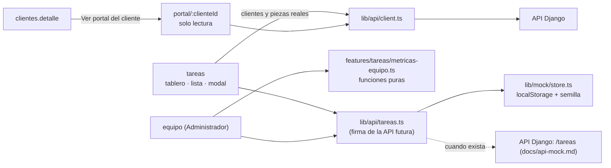

# Módulo 5 — Supervisión del Equipo de Trabajo

Estado: **terminado y verificado por QA** (sin defectos), con un **backend simulado** en el navegador porque la API
aún no tiene este módulo. En este módulo también se entregó lo que faltaba del módulo 1: la **vista previa del portal
del cliente**. Contrato propuesto al backend: `docs/api-mock.md`.

## Qué se hizo

| Pantalla                                      | Detalle                                                                                                                                                                                                                                                                                                                                                                                                                                                                    |
| --------------------------------------------- | -------------------------------------------------------------------------------------------------------------------------------------------------------------------------------------------------------------------------------------------------------------------------------------------------------------------------------------------------------------------------------------------------------------------------------------------------------------------------- |
| **Tareas** (`/tareas`, todos)                 | Reemplaza Google Tasks. Tareas de elaboración de contenido con título, descripción, **cliente real**, pieza opcional (real), persona asignada, plazo, prioridad y estado (Pendiente → En progreso → En revisión → Completada). Vista **tablero** por estado y vista **lista**; filtros Mis tareas/Todas, cliente, persona y vencidas; las vencidas (plazo anterior a hoy en Colombia) se resaltan. El Personal crea tareas y actualiza las suyas; el Administrador, todas. |
| **Equipo** (`/equipo`, Administrador)         | "Ver en tiempo real el avance por cliente, las tareas vencidas y la carga de cada persona": por persona, abiertas, vencidas, completadas en 7 días y barra de carga; por cliente, % de avance y vencidas; lista de vencidas con enlace. Los cálculos son funciones puras con pruebas (`features/tareas/metricas-equipo.ts`).                                                                                                                                               |
| **Portal del cliente** (`/portal/:clienteId`) | Charter, módulo 1: vista **de solo lectura** con el resumen de sus redes, el alcance del último mes por red y sus próximas publicaciones, sin ningún control de edición. Usa **datos reales**; como la API todavía no tiene rol cliente, hoy la abre un usuario interno desde la ficha del cliente ("Ver portal del cliente") con una banda que indica que es una vista previa.                                                                                            |

### Backend simulado (mock)

- `lib/mock/store.ts`: almacén en `localStorage` (con respaldo en memoria si el navegador lo bloquea), latencia
  simulada y datos semilla.
- `lib/api/tareas.ts` expone funciones **con la misma forma que tendrá la API REST** (`listTareas`, `createTarea`,
  `updateTarea`…). Cuando el backend implemente los endpoints de `docs/api-mock.md`, se cambia solo esa capa.
- Todas las pantallas con datos simulados muestran el aviso "Datos de demostración".
- Limitación conocida: los datos viven en el navegador (no se comparten entre equipos). El Personal no tiene permiso
  para listar usuarios, así que el directorio de personas se siembra cuando el Administrador inicia sesión.

## Verificación

- Pruebas automáticas: persistencia y respaldo del almacén, vencidas, carga y avance del equipo, filtros de tareas.
- **QA (Sol, instancia nueva) en navegador**, con director y personal: crear/editar/cambiar estado, tablero, lista y
  filtros, persistencia tras recargar, permisos sobre tareas ajenas (403 en el mock), métricas del equipo coherentes,
  portal con datos reales (Café La Montaña: octubre, Instagram 14.200 y Facebook 9.088), 360 px y consola.
  **Sin defectos.**

## Arquitectura

## Cómo administré los subagentes

| Agente     | Modelo              | Tarea                                                                                                                                                                                                                                                   |
| ---------- | ------------------- | ------------------------------------------------------------------------------------------------------------------------------------------------------------------------------------------------------------------------------------------------------- |
| Yo (líder) | —                   | Definí la estrategia de mock: una capa `lib/api/*` con la forma de la API real sobre un almacén local, aviso visible y contrato documentado para el backend; decidí entregar el portal con datos reales en lugar de inventarlos. Integración y commits. |
| Sol F      | gpt-6.1-sol         | Almacén mock, tareas, equipo, portal y contrato `docs/api-mock.md`.                                                                                                                                                                                     |
| Sol QA     | gpt-6.1-sol (nueva) | Pruebas de punta a punta.                                                                                                                                                                                                                               |

Se construyó **en paralelo** con el módulo 3 y con los QA de los módulos 2 y 4.

## Pendiente (backend)

- API de tareas (`docs/api-mock.md`) y un directorio de personas accesible para el Personal.
- Rol **CLIENTE** con su propio inicio de sesión y un endpoint de resumen, para que el portal deje de ser vista previa.
